# TP05: Real-Time Data Streaming and Processing Using Apache Kafka

**University of Eloued, Faculty of Exact Sciences, Master 2 IA & Data Science, Big Data Analytics (2026/2027)**

A smart-campus scenario: simulated sensors publish temperature and humidity events to Apache Kafka (single broker, KRaft mode, Docker Compose). A Python consumer reads the stream in real time and raises an alert when the temperature is 35°C or higher.

```
producer.py  ──►  Kafka broker (Docker, localhost:9092)  ──►  consumer.py
(sensor sim.)     topic: campus-sensors (3 partitions)        (parses JSON, prints, ALERT if T ≥ 35°C)
                  ├─ Partition 0
                  ├─ Partition 1
                  └─ Partition 2
```

## Project structure

```
tp05-kafka/
├── compose.yaml            Kafka broker (KRaft mode)
├── requirements.txt        Python dependency
├── producer.py             Base producer (30 events, includes campus_building field)
├── consumer.py             Base consumer (group tp05-campus-monitor)
├── producer_100.py         Further investigation: producer sending 100 events
├── producer_1p.py          Further investigation: producer for the 1-partition topic
├── consumer2.py            Further investigation: consumer with a different group_id
├── consumer_partitions.py  Further investigation: prints partition and offset
├── consumer_1p.py          Further investigation: consumer for the 1-partition topic
├── consumer_avg.py         Further investigation: running average temperature
├── consumer_building.py    Further investigation: filters events from building A
├── README.md
└── screenshots/
```

## Setup instructions

Prerequisites: Docker Desktop (running), Python 3.10 or later, pip.

```powershell
# 1. Start Kafka
docker compose up -d
docker compose ps
docker compose logs --tail=50 kafka

# 2. Python environment
python -m venv .venv
.venv\Scripts\Activate.ps1
python -m pip install -r requirements.txt

# 3. Create the topic (3 partitions, replication factor 1)
docker exec -it tp05-kafka /opt/kafka/bin/kafka-topics.sh --bootstrap-server localhost:9092 --create --if-not-exists --topic campus-sensors --partitions 3 --replication-factor 1
docker exec -it tp05-kafka /opt/kafka/bin/kafka-topics.sh --bootstrap-server localhost:9092 --describe --topic campus-sensors

# 4. Run the stream (two terminals, start the consumer first)
python consumer.py     # terminal 2
python producer.py     # terminal 1

# 5. Inspect the consumer group
docker exec -it tp05-kafka /opt/kafka/bin/kafka-consumer-groups.sh --bootstrap-server localhost:9092 --list
docker exec -it tp05-kafka /opt/kafka/bin/kafka-consumer-groups.sh --bootstrap-server localhost:9092 --describe --group tp05-campus-monitor

# 6. Cleanup
docker compose down        # keeps the data volume
docker compose down -v     # also deletes the stored messages
```

Note: `requirements.txt` pins `kafka-python==3.0.12` instead of the `2.0.2` given in the TP, because 2.0.2 does not import on Python 3.12 (see "Problems and solutions").

---

## Results and evidence

### 1. Running container (Task 1)
Kafka 3.9.1 runs in KRaft mode (broker and controller in one node), port 9092 mapped to the host.

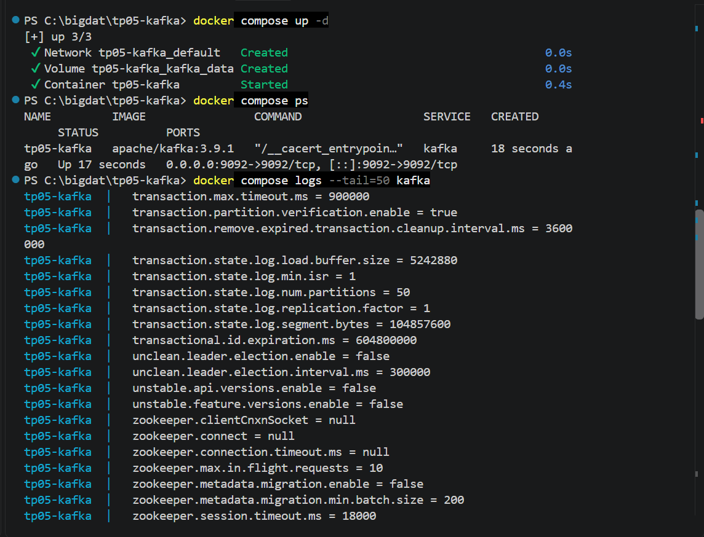

### 2. Topic description (Task 5)
The topic `campus-sensors` has 3 partitions and replication factor 1. For all three partitions, Leader, Replicas and Isr are 1 (the only broker).

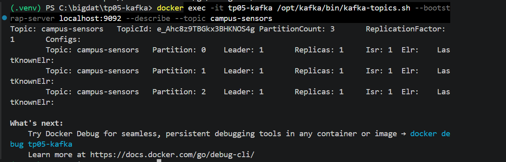

### 3. Producer output (Task 3)
The producer sends one JSON event per second (30 events) with `event_id`, `sensor_id`, `temperature_c`, `humidity_pct` and `timestamp`.

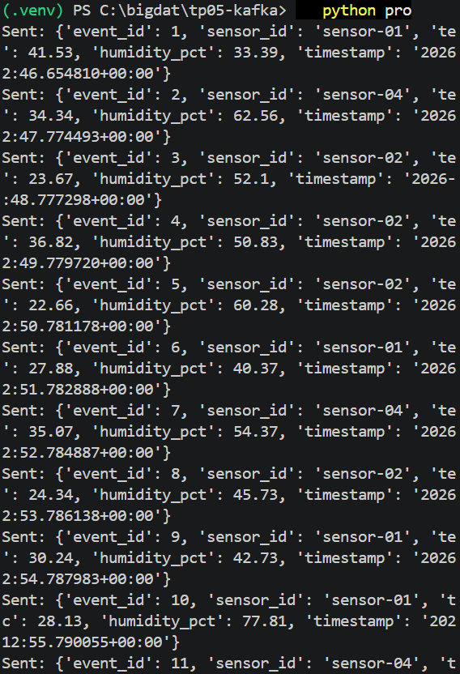

### 4. Consumer output (Task 4)
The consumer parses each JSON event, prints the measurement, and prints `ALERT` when the temperature is 35°C or higher. The events printed by the consumer match the events sent by the producer (same values and timestamps).

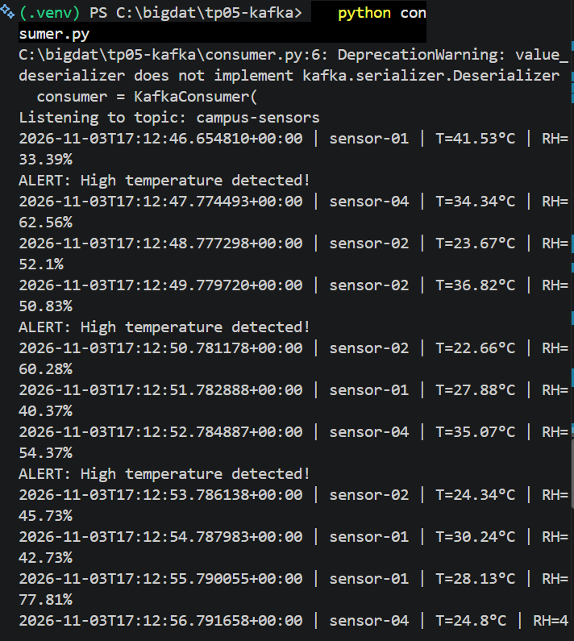

### 5. Consumer group offsets
After the first run, the group `tp05-campus-monitor` had read 11 + 7 + 12 = 30 events (one per event sent), with a lag of 0 on every partition. The group shows "no active members" because the consumer had been stopped, but Kafka keeps the offsets.

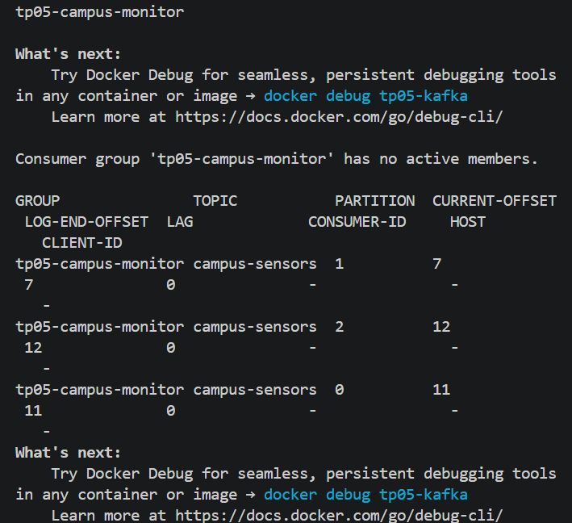

---

## Further investigation

### New group_id
`consumer2.py` uses `group_id="tp05-group-b"`. It immediately replayed the stored events without the producer running, because a new group has no committed offsets, so `auto_offset_reset="earliest"` starts it at the beginning. The original group, which had already read everything, printed nothing when restarted. After reading 30 of the 60 events then stored, group B had a lag of 30 (offsets 11 + 7 + 12 read, log ends 24 + 13 + 23), while `tp05-campus-monitor` had a lag of 0 and had read 60. The two groups are independent and each tracks its own progress over the same data.

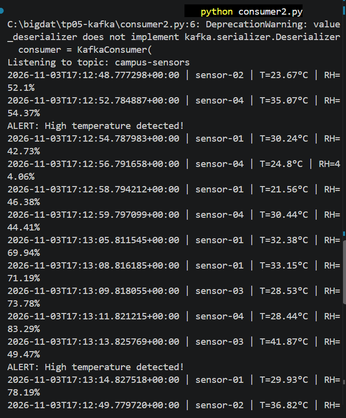
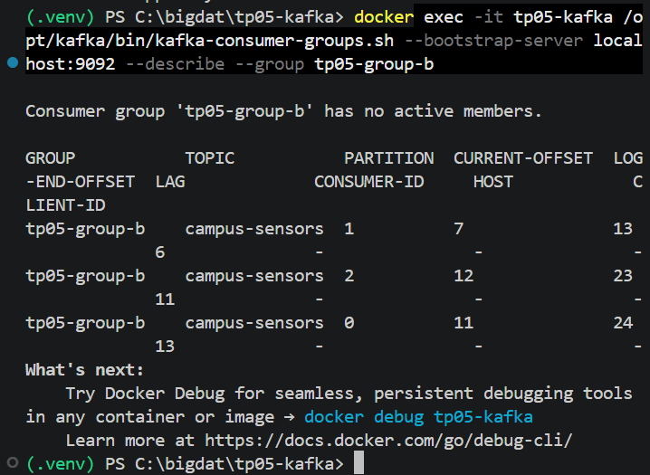
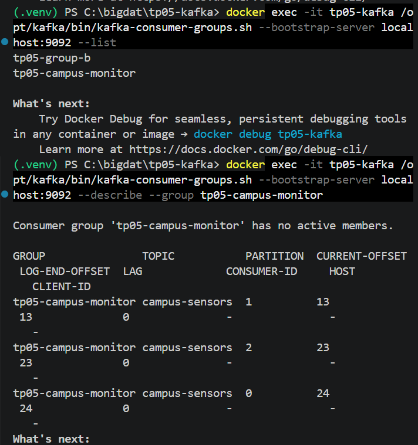

### Two consumers in the same group
Two copies of `consumer_partitions.py` ran in the group `tp05-campus-monitor`. Kafka split the 3 partitions: one consumer owned partitions 0 and 1, the other owned partition 2. Each event appeared in only one terminal.

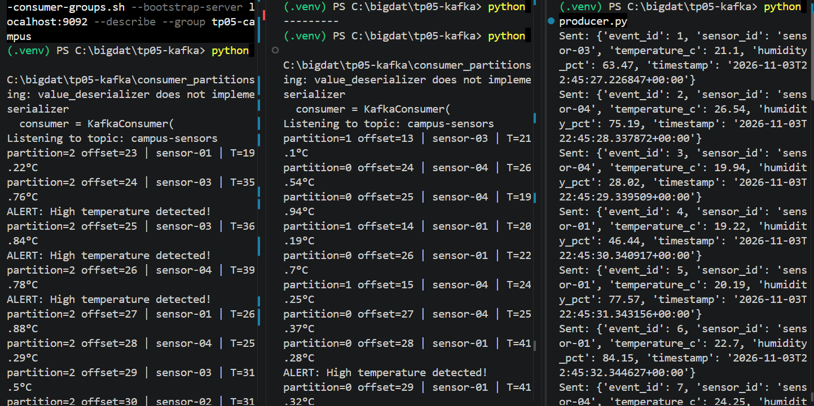
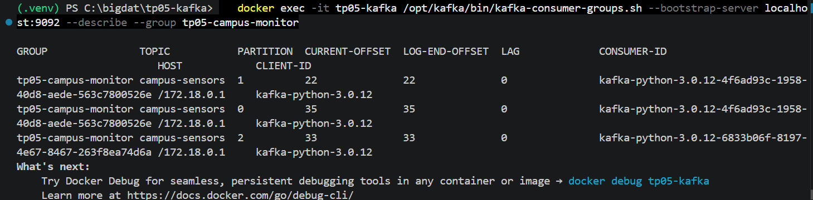

### 1 partition versus 3 partitions
A second topic `campus-sensors-1p` was created with one partition. With two consumers in the same group, only one received events (all with `partition=0`, offsets 0 to 29 in strict order) and the other stayed silent, because a partition can be owned by only one consumer of a group.

| | 1 partition | 3 partitions |
|---|---|---|
| Ordering | Total order across the topic | Order only within each partition |
| Parallelism in one group | At most 1 active consumer | Up to 3 active consumers |
| Distribution | All events in partition 0 | Spread over partitions 0, 1, 2 |

What does not change on a single broker: there is still one broker as leader of every partition, replication factor is still 1 (no fault tolerance), and the throughput limit is still that of one machine.

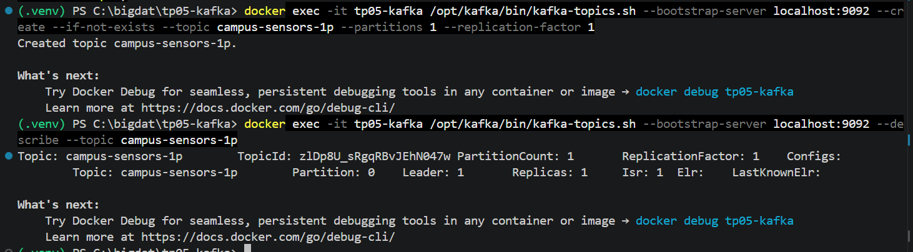
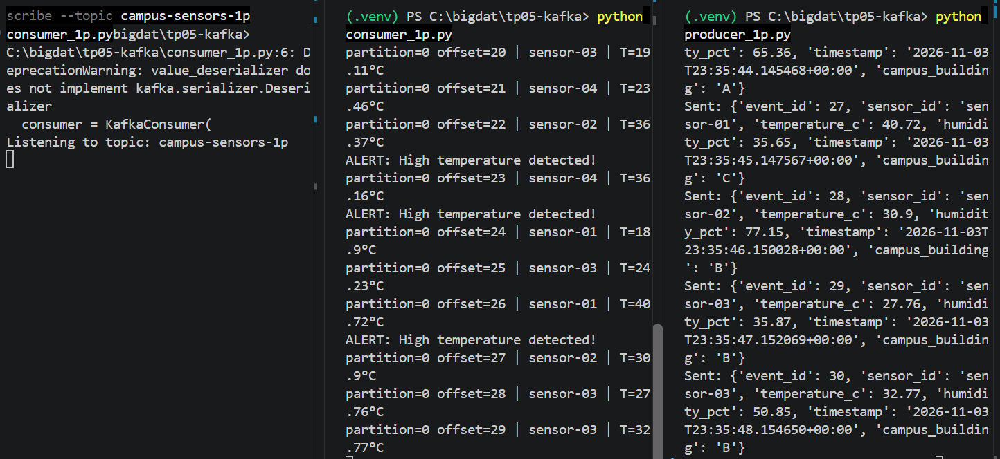
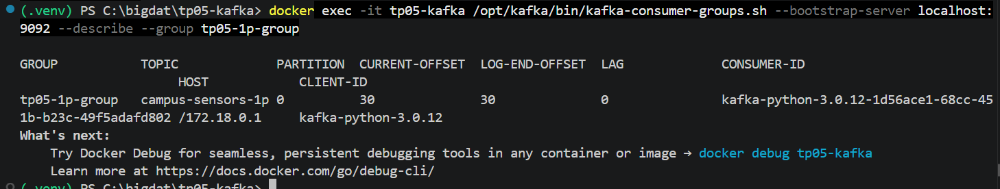

### Running average
`consumer_avg.py` keeps only a `total` and a `count`, so it uses constant memory on an endless stream. After replaying 90 events the average was 29.86°C, close to the theoretical mean of 30°C (the temperatures are uniform between 18 and 42).

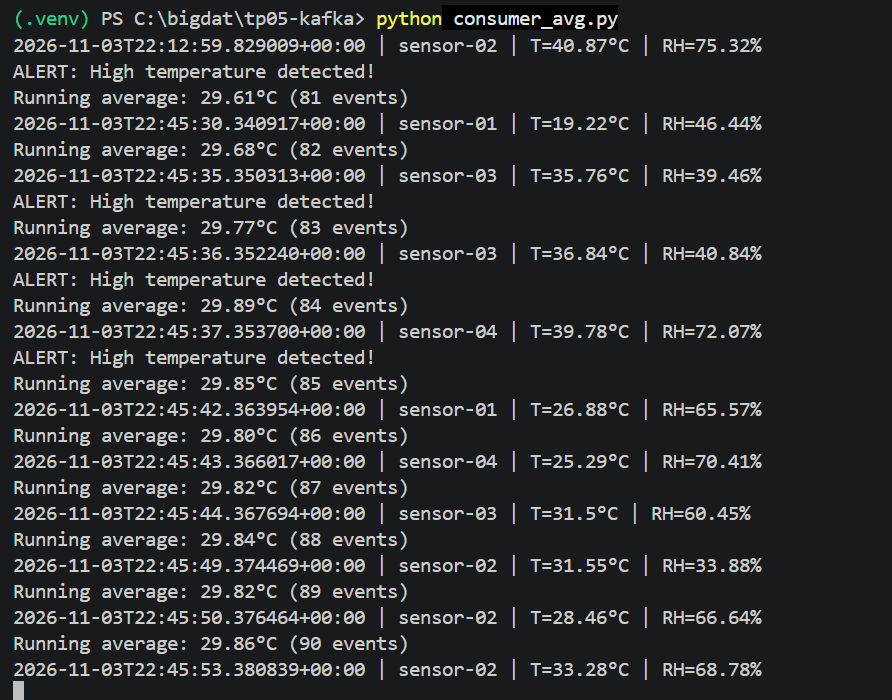

### campus_building field and filter
A `campus_building` field (A, B or C) was added to the events, and `consumer_building.py` prints only the events from building A. The filtering is done in the consumer: Kafka still delivers every event, and the consumer decides which ones to keep. Old events without the field are skipped with `event.get("campus_building")`.

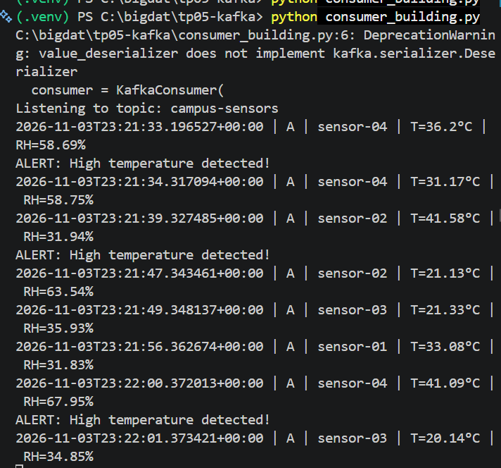

### 100 events
`producer_100.py` sends 100 events instead of 30. The behavior is the same (live flow, alerts at 35°C or higher, events spread over the partitions), only the run is longer. At the end, the group `tp05-campus-monitor` had a lag of 0 and offsets 84 + 82 + 84 = 250, which matches all the events sent during the lab.

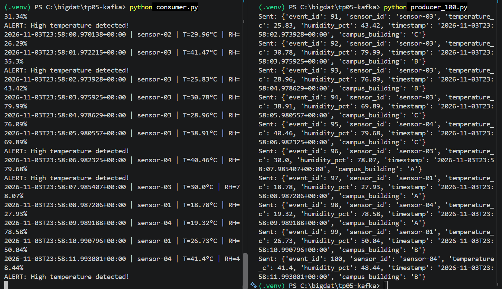
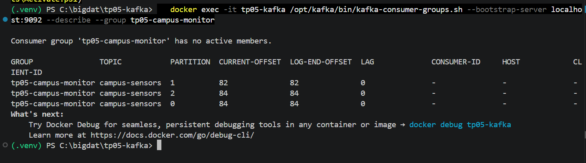

### Observations worth noting
- **Backlog:** the producer ran twice while no consumer of the group `tp05-campus-monitor` was running. When `consumer.py` was started, it printed the 60 missed events immediately, before any new producer run. Kafka stored the events and the group resumed from its committed offsets.
- **Ordering:** when a consumer replays a backlog, the timestamps jump backwards between partitions. Order is guaranteed only inside a partition, not across the whole topic.

---

## Answers to the report questions

**1. What problem does Apache Kafka solve in a data-streaming architecture?**
Kafka is a distributed event-streaming platform that sits between the systems that produce data and the systems that use it. Producers publish events without knowing who will read them, and several applications can read the same events independently and at their own pace. Without Kafka, readings stored only in static files delay the analysis, and connecting every service directly to every other service is hard to maintain. Kafka decouples the services, buffers the load, stores events for a configured retention period (7 days by default), and lets consumers replay events.

**2. Definitions**
- **Producer:** an application that publishes events to a topic (`producer.py`).
- **Consumer:** an application that reads events from a topic (`consumer.py`).
- **Broker:** a Kafka server that stores partitions and handles producer and consumer requests (the `tp05-kafka` container).
- **Topic:** a named category of events (`campus-sensors`).
- **Partition:** an ordered, append-only log that is a part of a topic. Partitions allow parallelism.
- **Offset:** the position number of an event within a partition.
- **Consumer group:** a set of consumers that share the work of reading a topic. Each partition is assigned to at most one consumer of the group at a time, and the group's progress (offsets) is tracked by its `group_id`.

**3. Difference between a topic and a partition**
A topic is the logical stream of events, a category with a name. A partition is a physical part of that topic: an ordered log with its own offsets. A topic is made of one or more partitions. Ordering is guaranteed only inside a partition, not across the whole topic. In this lab, `campus-sensors` has 3 partitions, and the 30 events were split between them (11, 7 and 12).

**4. Why `auto_offset_reset='earliest'`, and when does it apply?**
It tells a consumer where to start reading when its group has no valid committed offset: `earliest` means from the beginning of the partition, `latest` would mean only new events. With `earliest`, a new consumer does not miss the events already stored in the topic, for example if it starts after the producer. The setting applies only when there is no committed offset for the group (a new group, or an offset that no longer exists). Once the group has committed offsets, the setting is ignored and the consumer resumes where it stopped. This was observed in the lab: the new group `tp05-group-b` replayed the old events, and the existing group printed nothing when restarted.

**5. Purpose of the consumer group ID, and what happens with a new one**
The `group_id` identifies the consumer group. Kafka stores the committed offsets per group and per partition, and uses the group to distribute partitions among its members. Consumers with the same group_id share the work (each event goes to one of them), and consumers with different group_ids each receive all the events. If a new group_id is used, the group has no committed offsets, so with `auto_offset_reset='earliest'` it reads the topic from the beginning. In the lab, `tp05-group-b` replayed the stored events while `tp05-campus-monitor` was unaffected.

**6. Why is JSON suitable here? One limitation**
JSON is human-readable, supported by every language, easy to produce and parse in Python (`json.dumps` and `json.loads`), and it needs no schema setup, so it is easy to debug in a lab. One limitation is that it has no enforced schema or types, so a producer can change or drop a field and break consumers silently (this happened when old events had no `campus_building`). It is also more verbose and slower than binary formats such as Avro or Protobuf.

**7. How Docker Compose simplifies deployment compared with starting services manually**
Compose describes the whole environment in one declarative file, `compose.yaml`: image and version, container name, ports, environment variables, volumes and restart policy. One command (`docker compose up -d`) creates and starts it, and `docker compose down` removes it. Starting manually would mean a long `docker run` command with many options typed each time, which is easy to get wrong and hard to reproduce. The compose file can be versioned in Git, shared, and gives the same environment on every machine, with the same pinned image version (`apache/kafka:3.9.1`). It also needs no local installation of Java or Kafka.

**8. Limitations of this single-broker setup compared with a production cluster**
- There is no fault tolerance: replication factor 1 means one copy of each partition, so if the broker stops, the data is unavailable.
- There is no high availability: no other broker can take over as leader, and there is a single controller (no quorum redundancy).
- Throughput and storage are limited to one machine, so partitions give parallelism for consumers but not scalability across servers.
- There is no security: listeners use PLAINTEXT, with no authentication, authorization or TLS encryption.
- The advertised listener `localhost:9092` works only for clients on the same machine.
- Internal topics are set to replication factor 1, which is for practice only.
- Replication is not a backup, and a production system also needs monitoring (consumer lag, storage, replica health).

**9. Evidence**
See the screenshots in the "Results and evidence" section: running container (`01-compose-ps.png`), topic description (`02-topic-describe.png`), producer output (`03-producer.png`) and consumer output (`04-consumer.png`).

---

## Problems and solutions

| Problem | Cause | Solution |
|---|---|---|
| `failed to connect to the docker API ... dockerDesktopLinuxEngine` | Docker Desktop was not running | Started Docker Desktop and waited until the engine was running (`docker version` shows Client and Server) |
| `docker compose up` failed with `timeout awaiting response headers` for `registry-1.docker.io` | Temporary network timeout while reaching Docker Hub | Ran `docker pull apache/kafka:3.9.1` directly until it completed, then `docker compose up -d` |
| `ModuleNotFoundError: No module named 'kafka.vendor.six.moves'` | `kafka-python==2.0.2` is not compatible with Python 3.12.10 | Upgraded to `kafka-python==3.0.12` and updated `requirements.txt` |
| `DeprecationWarning: value_deserializer does not implement kafka.serializer.Deserializer` | kafka-python 3.x prefers a serializer class, but still accepts a plain function | Harmless warning, the consumer works normally |
| pip printed `getaddrinfo failed` retries | Temporary DNS problem on the network | pip retried automatically and the download succeeded |
| The restarted consumer printed nothing | The group had already committed its offsets, so there was nothing new to read | Expected behavior: it printed as soon as the producer sent new events. A new `group_id` replays the topic |
| The PDF text lost indentation and had line-wrap typos (`campussensors`) | PDF copy and paste | Rewrote the YAML and Python indentation by hand and used the correct topic name `campus-sensors` |
